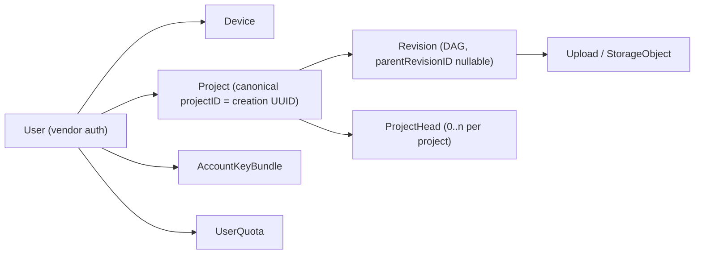
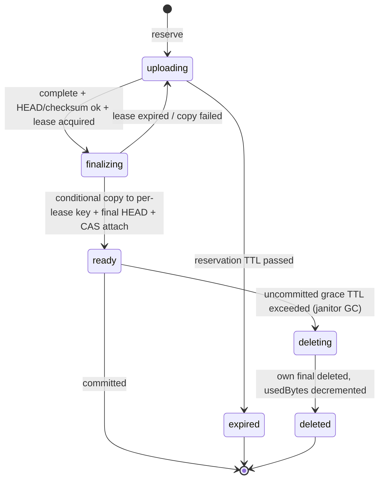

# SessionPort 0.2.0 -- API and Data

> **DRAFT -- awaiting owner approval. Architectural reference; a bounded local source subset is implemented, but no deployment or runtime acceptance is claimed.**
> The API and schema below remain proposed. Endpoints are marked **Current (local source)** or
> **Planned (not mounted)**; planned endpoints are not availability claims. Candidate values
> (TTLs, limits) are gate inputs, not defaults. No application-database apply, live PostgreSQL
> proof, enabled production auth, storage/upload mount, or deployment exists. Standing safety
> constraints in `AGENTS.md` remain in force.
> Companion documents: [ARCHITECTURE.md](ARCHITECTURE.md), [SYNC_PROTOCOL.md](SYNC_PROTOCOL.md),
> [SECURITY.md](SECURITY.md).

## 1. Conventions

- Base path: `/v1` for the business API. Native auth lives under `/api/native/v1/*`; the browser
  BetterAuth bridge lives under `/api/auth/*` (section 3).
- Transport: HTTPS only, JSON. No wildcard CORS.
- **Two verified principals (no others):**
  - **Plugin (native device):** `Authorization: Bearer <opaque access token>`. The API resolves the
    token fingerprint and checks expiry plus the active, bound device/grant, audience/resource, and
    scopes on **every device request**, so application revocation takes effect immediately. There is
    no JWT and no cookie fallback.
  - **Browser dashboard:** cookie session only, forwarded through the allowlisted same-origin BFF to
    the authoritative Fastify API. Fastify validates the session itself (active user) plus
    CSRF/origin checks; the browser never holds or fabricates a device bearer token, and the BFF
    cannot assert an arbitrary user header -- there is no public bypass.
- IDs: UUIDs (`deviceID`, `projectID`, `revisionID`, `uploadID`, `requestID`).
- Sequence numbers: **JSON decimal strings** (`"42"`), never JSON numbers.
- Timestamps: ISO 8601 UTC with `Z`.
- Idempotency is **resource-ID based only** in 0.2: `uploadID`, `revisionID`, `projectID`, and the
  key-bundle CAS version. There is no generic `Idempotency-Key` header or idempotency persistence
  table. Retries compare only visible immutable fields (the server cannot decrypt payloads).
- Errors:

```json
{
  "error": {
    "code": "upload-not-ready",
    "message": "The upload is not ready for this operation.",
    "retryable": false,
    "requestID": "0f0a2c3e-8c2a-4e5b-9d3f-1b2c3d4e5f60"
  }
}
```

- Error messages never contain sensitive text (no plaintext names, paths, content, or raw vendor
  errors).
- Status codes used: `401` unauthenticated, `403` forbidden/revoked, `404` not found (scoped to the
  user), `409` conflict/CAS/state, `410` gone -- explicitly reserved for an expired upload
  reservation (`upload-expired`) and distinct from invalid cursors, `413` payload too large,
  `422` validation (including `INVALID_CURSOR`), `429` rate limited (with `Retry-After`), `503`
  unavailable (with `Retry-After`).
- The API accepts only opaque IDs, sizes, `keyEpoch`, and ciphertext SHA-256. It never accepts or
  returns plaintext session names, paths, or content digests.

### 1.1 Endpoint authorization matrix

Shared endpoints are user-scoped; the rest are device-only because they operate on ciphertext or keys.

| Endpoint | Plugin (device bearer) | Browser dashboard (cookie) | Status |
| --- | --- | --- | --- |
| `GET /v1/me` | yes (own user) | yes (own user) | **Current (local source)** |
| `GET /v1/projects` | yes (own user) | yes (own user) | **Current (local source)** |
| `POST /v1/projects` | yes (device only) | no | **Current (local source)** |
| `GET /v1/projects/:projectID/revisions` | yes (device only) | no | **Current (local source)** |
| `POST /v1/projects/:projectID/revisions` (commit) | yes (device only) | no | **Current (local source)** |
| `GET /v1/devices`, `DELETE /v1/devices/:id` | yes (own user) | yes (own user) | **Planned (not mounted)** |
| `POST /v1/uploads`, `POST /v1/uploads/:id/complete` | yes | no | **Planned (M4; not mounted)** |
| `GET /v1/revisions/:id/download` | yes | no | **Planned (M4; not mounted)** |
| `GET /v1/key-bundle`, `PUT /v1/key-bundle` | yes | **never** (the browser must not retrieve the wrapped root) | **Planned; not mounted** |
| `GET /health/live`, `GET /health/ready` | unauthenticated probes | unauthenticated probes | **Current; readiness remains 503 while migrations/storage checks are false** |

**Scope note.** The current source surface uses `GET /api/native/v1/grants` and `POST /api/native/v1/grants/:grantID/revoke` for browser grant list/revoke; it does **not** implement `GET /v1/devices` or `DELETE /v1/devices/:id`.

## 2. Resource model (overview)



## 3. Auth endpoints (current local source surface)

The native path uses SessionPort-owned opaque, stateful credentials, not JWT access tokens or vendor
device/OAuth-provider plugins. Credentials are high-entropy values whose fingerprints and grant state
are checked on every bearer request. This supersedes the earlier vendor-native-device proposal for
the native path only; BetterAuth 1.7.11 remains the browser GitHub authority.

Native methods (nine, under `/api/native/v1/*`; local source, no runtime acceptance):

- `GET /session` -- browser session DTO `{ user, csrfToken }`; the CSRF token is HMAC-bound to the
  API-read session ID and validated by the API.
- `POST /device-authorizations` -- public create; returns device code, human code, fixed verification
  URI, and poll interval.
- `GET /device-authorizations/verify` -- fixed browser redirect to `/device`; no code in the URI.
- `POST /device-authorizations/verify` -- browser only; consent response is wrapped as
  `{ consent: { account, scopes, expiresAt } }`.
- `POST /device-authorizations/approve` and `POST /device-authorizations/deny` -- browser only,
  session plus CSRF/origin/confirmation.
- `POST /token` -- public device-code exchange or refresh rotation.
- `GET /grants` -- browser-only own-user grant list.
- `POST /grants/:grantID/revoke` -- browser-only own-user revocation.

Browser BetterAuth bridge (four routes under `/api/auth/*`, GitHub only): `GET /get-session`,
`GET /callback/github`, `POST /sign-in/social`, and `POST /sign-out`. The BFF forwards the session
cookie and API-issued CSRF header without holding a CSRF secret; the API remains the session and token
authority. No `GET /v1/devices` or `DELETE /v1/devices/:id` route is implemented; grant list/revoke is
the native route above. These are local source routes with synthetic tests only: no real OAuth,
live database, CSRF runtime, or deployment acceptance is claimed.

## 4. Endpoints

### 4.1 `GET /v1/me` — current local source

Usage and limits.

```http
GET /v1/me
```

```json
{
  "userID": "user_01H...",
  "limits": {
    "storageLimitBytes": 1073741824,
    "storageUsedBytes": 268435456,
    "storageReservedBytes": 67108864,
    "maxCiphertextBytes": 104857600,
    "maxActiveDevices": 3,
    "maxActiveProjects": 10
  },
  "counts": { "activeDevices": 2, "activeProjects": 3 }
}
```

`maxCiphertextBytes` is the configurable **ceiling**; the effective client cap is 66 MiB until the
cloud crypto profile is validated (see [SYNC_PROTOCOL.md](SYNC_PROTOCOL.md) section 2).

**Current source note:** the DTO and quota-row reads exist in local source with fake-client tests;
there is no live quota-row/concurrency proof. On 2026-10-24 the owner approved one narrow explicit
opt-in for the approved device exchange: when the operator sets the optional backend policy field
`initialStorageLimitBytes`, cloud composition may provision a new quota row for an approved account
that has none. There is **no auto quota**: omitting the field keeps legacy `quota-not-provisioned`
behavior, the value never overwrites an existing limit or counter, and there is no implicit/default
1 GiB grant. This approval does not extend to billing/admin approvals or production deployment.

### 4.2 Devices — planned, not mounted

- `GET /v1/devices` -> `{ "devices": [{ "id", "name", "status", "createdAt", "lastSeenAt" }] }`
- `DELETE /v1/devices/:id` -> `204`. Marks the device inactive in a transaction, then revokes the
  provider refresh grant. API access is denied immediately after the transaction; outstanding
  signed URLs expire on their own short clock (5 minutes candidate).

### 4.3 Projects — current local source

- `GET /v1/projects` -> list of projects. The canonical public identifier is `projectID`, which
  **equals the UUID chosen by the client at creation**; there is no separate `projectUUID` field.
  The value is copied between checkouts/devices for explicit linking.

```json
{
  "projects": [
    {
      "projectID": "5d4e...",
      "encryptedLabel": "base64...",
      "createdAt": "2026-10-18T12:00:00Z",
      "headIDs": ["7c1a..."],
      "revisionCount": 12
    }
  ]
}
```

- `POST /v1/projects` -> create or explicitly link. Body: `{ "projectID": "...", "label": "..." }`
  (`label` optional and encrypted client-side). If the user already owns that `projectID`, the
  existing project is returned (`200`, idempotent link); otherwise `201` creates it. Active project
  count is enforced under the quota row lock (`maxActiveProjects`).

### 4.4 Revisions (event pages) — current local source

`GET /v1/projects/:projectID/revisions?after=<seq>&upperBound=<seq>&limit=<n>`

- `after` is a decimal position string (zero is valid). `upperBound` freezes the page anchor: the
  first request may omit it and the server uses the current project maximum; subsequent pages MUST
  echo the same `upperBound`, so pages never skip or repeat a gap.
- Response:

```json
{
  "upperBound": "42",
  "nextAfter": "41",
  "hasMore": false,
  "currentHeadIDs": ["7c1a...", "9d2b..."],
  "revisions": [
    {
      "revisionID": "7c1a...",
      "parentRevisionID": null,
      "seq": "41",
      "deviceID": "44aa...",
      "keyEpoch": 1,
      "sizeBytes": 1048576,
      "ciphertextSha256": "base64...",
      "createdAt": "2026-10-18T12:00:00Z"
    }
  ]
}
```

- `nextAfter` is the max `seq` returned (empty page: null); `hasMore` states whether more revisions
  exist at or below `upperBound`. Pages are contiguous: the next request reuses `nextAfter`
  unchanged. `limit=0` is valid and returns an empty page; an empty project returns an empty page
  with `hasMore: false`.
- `currentHeadIDs` is a live read (not governed by `upperBound`) and is labeled as current; clients
  must not treat it as frozen for the anchor. A frozen per-anchor head set is not served.
- **Current source note:** the local repository stores sequence/size values as BigInt and serializes
  them as decimal strings, uses lowercase fixed error codes, preserves all sibling heads on commit,
  and has no automatic merge path. This is source/test behavior, not live PostgreSQL proof.
- Cursors are stateless; there is no cursor table and all committed revisions are retained (no
  compaction/purge planned). A numeric cursor is only a **position**: scope comes from the route
  `projectID` plus the device's locally stored `projectID`, and a numeric value inside range is just
  an allowed position, not a proof of origin. `422 INVALID_CURSOR` is returned only for malformed
  values (non-decimal, negative) or values beyond the established `upperBound`; there is no
  retention-based cursor expiration.

### 4.5 Uploads — planned (M4), not mounted

`POST /v1/uploads` -- reserve exact bytes and create a staging target.

```json
{
  "uploadID": "aa11...",
  "projectID": "5d4e...",
  "revisionID": "bb22...",
  "parentRevisionID": "cc33...",
  "bytes": 1048576,
  "ciphertextSha256": "base64...",
  "keyEpoch": 1
}
```

Response (`201`):

```json
{
  "uploadID": "aa11...",
  "state": "reserved",
  "staging": {
    "url": "https://storage.example.com/...",
    "fields": { "policy": "...", "key": "staging/...", "x-amz-checksum-sha256": "..." }
  },
  "expiresAt": "2026-10-18T12:05:00Z"
}
```

- Reserve validates, then accounts:
  1. idempotent fast path: an existing `uploadID` with matching visible immutable fields returns
     the existing reservation **before any quota check**, so a retry at quota-full still succeeds;
  2. if the revision is already committed, the existing commit result is returned with no new
     reservation;
  3. revision intent: a locked unique intent (`userID + projectID + revisionID`, partial unique
     across non-terminal states) prevents duplicate ready uploads; a matching `ready` row is reused
     instead of re-charged;
  4. the project must be owned and active and `parentRevisionID` must be a known committed parent
     of that project (`404`/`422`);
  5. only then is the quota row locked and `used + reserved + new <= limit` checked.
- Over-limit or over-`maxCiphertextBytes` -> `413`/`422`; local state is unaffected.
- `409` cases: same `uploadID` reused with a different request; conflicting revision intent; staging
  key already finalized. A retry after reservation expiry uses a **new `uploadID`** with identical
  revision fields and the **same persisted ciphertext** (visible immutable fields only).
- `projectID`, `parentRevisionID`, `deviceID`, and `keyEpoch` are bound into the immutable Upload
  row at reserve; `keyEpoch` is `1` in 0.2 (no other value accepted).

`POST /v1/uploads/:id/complete` -- finalize.

```json
{ "state": "ready", "revisionID": "bb22...", "sizeBytes": 1048576, "ciphertextSha256": "base64..." }
```

- While a live finalization lease exists, `complete` returns `202` with `Retry-After` and does
  **not** steal the lease. `409` is returned for state conflicts that are not retryable.
- The server HEADs the staging object (length + checksum), conditionally copies to a final key
  **only if the source ETag is unchanged**, HEADs the final object, then attaches it in a database
  transaction under the lease token, marks the upload `ready`, charges `usedBytes` exactly once,
  and releases the reservation. Final keys are unique per (upload, lease generation).
- Completion is idempotent per `uploadID`/`revisionID` (a retry checks the committed/ready state
  first, so there is no double charge). The same staging key with a different request returns
  `409`. An expired reservation returns `410 upload-expired`; the client re-reserves the same
  revision under a new `uploadID`. See section 5 for the state machine.

### 4.6 Commit — current local source

`POST /v1/projects/:id/revisions`

```json
{ "revisionID": "bb22...", "uploadID": "aa11...", "parentRevisionID": "cc33..." }
```

Response (`201`; `200` when idempotent):

```json
{ "revisionID": "bb22...", "seq": "42", "headIDs": ["bb22..."], "conflict": false }
```

- `conflict` is `true` when the declared parent was no longer in the head set at commit time
  (sibling commit). The commit still succeeds; both siblings survive (see
  [SYNC_PROTOCOL.md](SYNC_PROTOCOL.md) section 5.3 for the transaction pseudocode).
- Validation failures: `422` unknown parent or `parentRevisionID` required/must be null for the
  initial revision; `409` upload not ready, upload in cleanup (`deleting`/`deleted`), or revision ID
  reused with different visible immutable fields
  (user/project/parent/ciphertextSha256/bytes/keyEpoch/device when bound).

### 4.7 Download — planned (M4), not mounted

`GET /v1/revisions/:revisionID/download` -> `200`:

```json
{ "url": "https://storage.example.com/...", "expiresAt": "2026-10-18T12:10:00Z", "sizeBytes": 1048576, "ciphertextSha256": "base64..." }
```

- Signing only. The revision must be ready (`state = committed`), belong to the user, and be
  authorized; otherwise `404`/`409` as appropriate. No arbitrary object keys are accepted.
- Presigned URLs are bearer credentials (5 minutes candidate); revocation does not retroactively
  invalidate an issued URL.
- The client fully validates the downloaded object (length, checksum, container authentication,
  envelope/manifest consistency) before any host import.

### 4.8 Key bundle — planned, not mounted

- `GET /v1/key-bundle` -> `{ "keyBundleVersion": 3, "keyEpoch": 1, "protocol": "sessionport-keybundle/1", "wrappedRoot": "base64...", "updatedAt": "..." }`
- `PUT /v1/key-bundle` -> create-if-absent or CAS update. Body:
  `{ "expectedVersion": null | 3, "keyEpoch": 1, "wrappedRoot": "base64..." }`.
  - `expectedVersion: null` creates the bundle if absent (`201`); if it exists -> `409`.
  - `expectedVersion: n` updates only if the stored version is `n` (`200`); otherwise `409`.
  - `keyEpoch` is fixed to `1` in 0.2: any other value is rejected (`422`). A CAS wrapper update
    (passphrase change over the same root) never changes the epoch silently.
  - The server stores the wrapper opaquely; it never receives the root or passphrase.

### 4.9 Health — current, readiness constrained

- `GET /health/live` -> `200 { "status": "ok" }` when the process is up.
- `GET /health/ready` -> `200` when database, migrations, and object storage checks pass; `503`
  otherwise. Current local source implements the database probe but deliberately keeps migrations
  and storage `false`, so it remains `503` even in cloud mode; no full database+storage readiness
  proof is claimed.
- Runtime mode is optional and defaults to **health-only**. Cloud mode (`SESSIONPORT_API_MODE`) is
  explicit and requires validated native-auth/browser configuration plus the exact
  `SESSIONPORT_BACKEND_POLICY_JSON` positive-integer bounds; there are no production defaults.

## 5. Upload/finalization state machine



Lease/fencing model:

- The upload row holds a monotonic `leaseToken` (bigint) and `leaseExpiresAt`. Lease duration is
  bounded (60 s candidate config), renewable by the owner; renewal extends `leaseExpiresAt` and
  keeps the same token unless ownership generation changes (recovery increments the token).
- The token is incremented only when a lease is acquired after expiry/recovery, or by cleanup before
  releasing resources -- never on every request.
- The final object key is deterministic for a given input pair and required to be unique per
  **(uploadID, leaseToken)** -- the preferred per-upload + lease-token scheme. Keys are never reused
  across lease generations, so a stale finalizer that completes its copy late writes only its own
  orphan key and cannot overwrite the winner's key.
- The database attach is a CAS requiring **state = `finalizing` AND token match AND unexpired lease
  AND row ownership** (not merely a matching token). A stale finalizer's attach fails; its copy is
  cleaned up as an orphan. Database fencing cannot stop a late S3 copy, so key uniqueness across
  lease generations is the real protection; the winner's final reference is immutable.
- Charge happens exactly once, in the successful attach transaction. A late stage that completes
  after expiration is never charged. Retries check `ready`/committed state before any accounting.
- Lock ordering: every mutation that changes quota acquires the `UserQuota` lock **before** the
  `Upload` lock (reserve, attach, janitor GC). Short lease acquisition that changes no quota may
  take the `Upload` lock alone. Error paths check the fencing token before changing state.

Reserve transaction:

```text
reserve(userID, deviceID, {uploadID, projectID, revisionID, parentRevisionID, bytes, ciphertextSha256, keyEpoch}):
  BEGIN
  # 1. idempotent fast path BEFORE any quota check
  existing = SELECT * FROM Upload WHERE id = uploadID AND userID = userID FOR UPDATE
  if existing:
      if visible immutable fields match -> return existing reservation (idempotent)
      else -> 409
  # 2. committed revision -> return existing commit result; no new reservation
  committed = SELECT * FROM Revision WHERE revisionID = revisionID AND projectID = projectID
  if committed -> return existing revision result (idempotent)
  # 3. revision intent: no duplicate active upload for the same revision
  intent = SELECT * FROM Upload
           WHERE userID = userID AND projectID = projectID AND revisionID = revisionID
             AND state IN (uploading, finalizing, ready, deleting)
           FOR UPDATE
  if intent:
      if visible immutable fields match -> reuse existing row (no new charge)
      else -> 409 revision-intent-conflict
  # 4. ownership/validation before accounting
  project = SELECT ... WHERE projectID = projectID AND userID = userID AND state = active
  if missing -> 404
  if parentRevisionID not a known committed parent of projectID -> 422
  if keyEpoch != 1 -> 422
  # 5. quota
  quota = SELECT * FROM UserQuota WHERE userID = userID FOR UPDATE
  if bytes <= 0 or bytes > config.maxCiphertextBytes: 422
  if quota.usedBytes + quota.reservedBytes + bytes > quota.limitBytes: 413
  if EXISTS(Upload WHERE stagingKey = newKey) -> 409
  INSERT Upload(state=uploading, projectID, revisionID, parentRevisionID, deviceID, keyEpoch,
                sizeBytes=bytes, ciphertextSha256, leaseToken=0, expiresAt=now+reservationTtl)
  quota.reservedBytes += bytes
  COMMIT
  return staging Post Policy {url, fields, expiresAt}
```

Finalize:

```text
complete(userID, uploadID):
  BEGIN
  upload = SELECT * FROM Upload WHERE id = uploadID AND userID = userID FOR UPDATE
  if upload missing -> 404
  if upload.state == ready -> return ready (idempotent; no double charge)
  if upload.state in (deleting, deleted) -> 409 cleanup-in-progress
  if upload.state == expired -> 410 upload-expired
  if upload.state == finalizing and upload.leaseExpiresAt > now -> 202 Retry-After (live lease; do not steal)
  leaseToken = upload.leaseToken + 1        # fence only on acquire-after-expiry/recovery
  upload.leaseToken = leaseToken
  upload.leaseOwner = me
  upload.leaseExpiresAt = now + leaseTtl    # bounded lease, 60 s candidate
  upload.state = finalizing
  COMMIT  # network work happens outside the DB transaction, under the lease

  # optional renewal: renew(userID, uploadID, leaseToken) extends leaseExpiresAt while
  # state=finalizing, owner=me, token matches; it never changes the token.

  head = HEAD stagingKey
  if head.length != upload.sizeBytes or head.checksum != upload.ciphertextSha256: fail -> uploading/expired
  finalKey = finalKeyFor(uploadID, leaseToken)  # unique per lease generation
  COPY stagingKey -> finalKey IF source ETag unchanged (conditional)
  headFinal = HEAD finalKey
  if headFinal.length != size or checksum mismatch: delete finalKey (own key only), fail

  BEGIN
  quota = SELECT * FROM UserQuota WHERE userID = userID FOR UPDATE   # quota lock BEFORE upload lock
  upload = SELECT * FROM Upload WHERE id = uploadID FOR UPDATE
  if upload.state == ready -> no-op (idempotent; no double charge)
  if upload.state != finalizing
     or upload.leaseToken != leaseToken
     or upload.leaseOwner != me
     or upload.leaseExpiresAt <= now -> stale finalizer: abandon attach; finalKey is an orphan
  attach finalKey; upload.state = ready
  quota.reservedBytes -= upload.sizeBytes
  quota.usedBytes += upload.sizeBytes
  COMMIT
```

Notes:

- Finalization is serialized via the row lock and fenced by `leaseToken`; a crashed copy leaves an
  orphan key that the janitor removes. Cleanup re-checks state and lease under the lock and deletes
  only unreferenced keys whose lease is terminal/fenced; it never deletes a key referenced by a
  `ready`/committed upload.
- Unattached `ready` uploads (ready but not committed) have a **24 h candidate grace TTL**; after it
  the janitor marks them `deleting`, deletes their own final keys outside the database transaction,
  then marks `deleted` and decrements `usedBytes` only after confirmed deletion (`404` is idempotent
  success). Commit and GC serialize on the upload row; commit rejects `deleting`.
- The Post Policy is reusable, so a staging key may reappear until expiry; cleanup is repeated and
  lifecycle rules apply (1 day candidate). A late stale copy is bounded by the lifecycle revisit.
- Lifecycle cleanup applies to staging objects and explicitly fenced orphan keys only. There is no
  blanket final-prefix expiry: committed revisions are retained and their final objects are never
  lifecycle-deleted.
- S3 operations are outside the database transaction. The design compensates for crash/copy races
  with reservation + revision intent + lease + per-lease keys + idempotent completion + orphan
  cleanup, so partial failures converge without double accounting.

## 6. Data model

Vendor auth tables are owned by BetterAuth (AUTH-01) and are not described here. The table below is
the **planning model**, not a live schema. The frozen source contract is
[m1-m3-schema-contract.md](../evidence/m1-m3-schema-contract.md), and it governs where the two
differ: the prepared source `Device` is `id`, `userID`, required unique `grantID`, `createdAt`,
`lastSeenAt` (no name/status/revokedAt); `Revision`/`ProjectHead`/`Upload`/`UserQuota` follow the
ledger. `AccountKeyBundle` remains planned and is not created.

| Table | Key fields | Notes |
| --- | --- | --- |
| `Device` | `id` UUID PK, `userID` FK, `grantID` required unique FK, `createdAt`, `lastSeenAt` | Active state derived from the grant; no name/status/revokedAt column, and no client-selected grant |
| `Project` | `projectID` UUID PK (= the creation UUID), `userID`, `encryptedLabel` nullable, `state` (active/purged), `createdAt` | Single canonical identifier; no separate `projectUUID` column |
| `Revision` | `revisionID` UUID PK, `projectID` FK, `parentRevisionID` nullable FK, `seq` bigint, `deviceID` FK, `keyEpoch`, `sizeBytes`, `ciphertextSha256`, `storageObjectKey`, `createdAt` | Unique `(projectID, seq)`; immutable; idempotent retry compares only these visible fields |
| `ProjectHead` | `(projectID, revisionID)` composite PK | Head set; rows removed only by a commit that advances past them |
| `Upload` | `id` UUID PK (= uploadID), `userID`, `projectID`, `revisionID`, `parentRevisionID`, `deviceID`, `keyEpoch`, `stagingKey` unique, `finalKey` unique nullable (unique per upload + lease token), `state` (uploading/finalizing/ready/deleting/deleted/expired), `sizeBytes`, `ciphertextSha256`, `leaseToken` bigint, `leaseOwner`, `leaseExpiresAt`, `expiresAt`, `graceExpiresAt`, `createdAt`, `completedAt` | Combined upload + storage object row (minimal first release); lease token fences finalization |
| `AccountKeyBundle` | `userID` PK, `keyBundleVersion` int, `keyEpoch` int, `protocol`, `wrappedRoot` bytea, `updatedAt` | Immutable epochs; CAS on version |
| `UserQuota` | `userID` PK, `limitBytes`, `usedBytes`, `reservedBytes`, `updatedAt` | Row-locked for reservation and quota checks |

Indexes and constraints:

- `Revision(projectID, seq)` unique; `Revision(parentRevisionID)` for DAG walks.
- `Project(userID)` (PK is `projectID`).
- `Device(userID, status)`; `Device(grantRef)` unique.
- `ProjectHead(projectID)`; `Upload(userID, state)`; `Upload(stagingKey)` unique; `Upload(finalKey)`
  unique; partial unique `Upload(userID, projectID, revisionID)` across non-terminal states
  (`uploading`, `finalizing`, `ready`, `deleting`) as the revision intent.
- All rows carry `userID` (tenant) ownership; every query is scoped by the authenticated user.
- Cross-row invariants (parent belongs to the same project, parent known and committed) are
  enforced in the commit transaction, not only by FK.

Cursor note: **no server cursor table is required.** Revisions carry ordering, cursors are stateless
and client-encrypted, and all committed revisions are retained (no compaction/purge planned), so
there is no retention-based cursor expiration. A numeric cursor is only a position: scope comes from
the route `projectID` plus the device's locally stored `projectID`; `422 INVALID_CURSOR` covers only
malformed values or values beyond the established `upperBound`. An optional
`DeviceProject(deviceID, projectID, cursorSeq)` row storing only ack metadata may be added later if a
concrete need is justified; otherwise it is out of scope.

Transactions vs. object storage: database transactions cannot include S3. The design uses
reservation + lease + per-lease final keys + idempotent completion so that partial failures
converge: a crashed copy or a stale finalizer leaves an orphan key (the janitor removes it), the
winning key is never overwritten, and a lost response is retried idempotently by
`uploadID`/`revisionID` with no double charge.

## 7. Quota and limits

Defaults (configurable):

| Limit | Value | Notes |
| --- | --- | --- |
| Storage limit | `1073741824` bytes (1 GiB) | `usedBytes + reservedBytes + new <= limitBytes` under the quota row lock |
| Active devices | 3 | Enforced on device activation under lock |
| Active projects | 10 | Enforced on project create/link under lock |
| Max ciphertext | `104857600` bytes (100 MiB) | Config **ceiling**, not a promise that 100 MiB payloads work |
| Effective client cap | 66 MiB | Until the cloud crypto profile is validated (CRYPTO-01) |
| Staging reservation TTL | 5 minutes | Candidate |
| Presigned URL expiry | 5 minutes | Candidate |
| Finalization lease | 60 seconds, renewable | Bounded lease candidate; renewal keeps the token |
| Uncommitted ready grace TTL | 24 hours | Janitor GC for `ready`-but-uncommitted uploads |
| Janitor interval | 5 minutes | Same API process |
| Staging lifecycle | 1 day | Candidate; applies to staging and explicitly fenced orphan keys only |

All committed revisions count against storage; there is no implicit purge. Quota-full blocks uploads
explicitly and never touches local sessions or local encrypted state. Staging physical overhead is
transient and excluded from logical usage; cost is bounded by outstanding reservations and rate
limits, not a zero-cost-abuse promise.

## 8. Janitor

Runs inside the same API process every 5 minutes, with a database lock using skip-locked semantics:

- Expire `uploading` reservations past `expiresAt` -> `expired` (`410 upload-expired` on use),
  releasing `reservedBytes` only when no live finalization lease owns the row.
- Recover `finalizing` rows whose lease expired: increment the fencing token **before** releasing
  anything or changing state.
- Unattached `ready` uploads (no committed Revision reference, no active commit) past the 24 h grace
  TTL are marked `deleting`; after their own final key is deleted (delete confirmed; `404` is
  idempotent success) the row becomes `deleted` and `usedBytes` is decremented **only after**
  confirmed deletion. Attach/commit and GC serialize on the upload row; commit rejects `deleting`.
- Never lifecycle-delete a final object referenced by a committed revision. Lifecycle applies to
  staging objects and explicitly known fenced orphan keys only -- there is no blanket final-prefix
  expiry (that would erase retained revisions).
- Lock ordering: any quota mutation acquires the `UserQuota` lock before the `Upload` lock
  (consistent with reserve/attach); Upload-lock-only lease work changes no quota.
- Delete staging objects past lifecycle (1 day candidate) and expired staging keys; cleanups are
  idempotent and repeatable.
- No external queue or worker is required; no cursor/table compaction runs.

## 9. Failure matrix (API level)

| Case | Status | Behavior |
| --- | --- | --- |
| Missing/expired access token | 401 | Client pauses and reauthorizes |
| Device revoked/inactive | 403 | API denies immediately |
| Unknown or other-user resource | 404 | Ownership-scoped lookup |
| Key-bundle CAS mismatch | 409 | Client re-fetches and re-prompts |
| Upload not ready | 409 | Client waits and retries `complete` |
| Live finalization lease | 202 | `Retry-After`; the lease is not stolen |
| Upload reservation expired | 410 `upload-expired` | Client re-reserves the same revision under a new `uploadID` with the same ciphertext |
| Unattached ready upload past grace TTL | janitor GC | `deleting` -> `deleted`; `usedBytes` decremented only after confirmed deletion; committed revisions never lifecycle-deleted |
| Malformed or beyond-upperBound cursor | 422 `INVALID_CURSOR` | Numeric values in range are positions, not origin proofs; no retention-based expiration |
| Revision-intent conflict | 409 | A locked active intent for the same revision prevents a second charge or duplicate ready upload |
| Stale finalizer CAS at attach | (internal) | Fence/state/expiry/ownership checks fail: abandon attach, own copy becomes an orphan, no charge; winning key untouched |
| Repeated complete/commit retry | 200/201 idempotent | Compares visible immutable fields; no double charge |
| Commit on `deleting`/`deleted` upload | 409 | GC and commit serialize on the upload row |
| Payload over limit | 413 | Explicit failure; local unaffected |
| Validation error | 422 | No partial writes |
| Rate limited | 429 | `Retry-After`; bounded backoff |
| Database/storage unavailable | 503 | `Retry-After`; no busy loop |

## 10. Open items

- PREP-01: owner approval of endpoint shape and limits; exact error message copy.
- AUTH-01 vendor schema/version validation before any auth table is used; AUTH-02 vault and
  credential-store selection.
- STORE-01 provider capability validation before uploads are enabled; STORE-02 must validate lease
  duration/renewal, the uncommitted-ready grace TTL, and exactly-once accounting.
- Whether `DeviceProject` ack metadata is ever justified (default: no cursor table).
