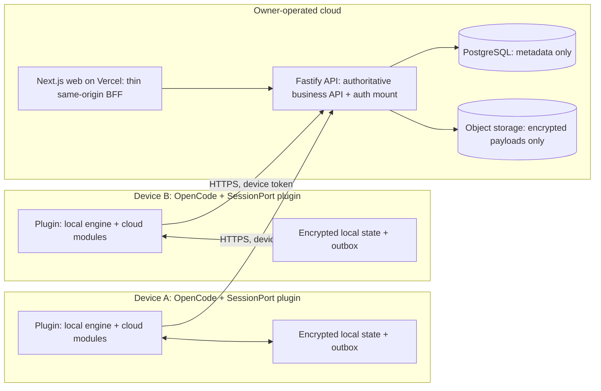
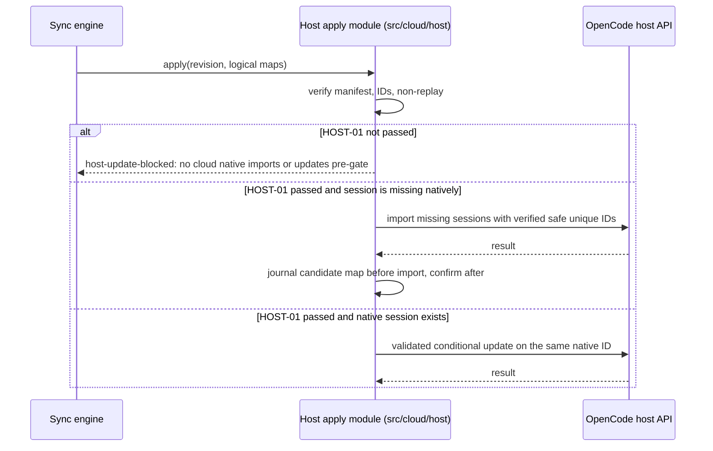
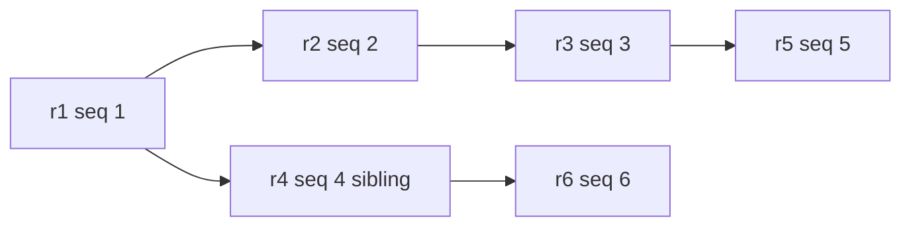

# SessionPort 0.2.0 -- Architecture

> **DRAFT -- awaiting owner approval. Architectural reference; local source implementation exists, but no deployment or runtime acceptance is claimed.**
> SessionPort 0.2.0 (optional cloud sync/continuity) remains a proposed design. The local
> checkpoint/restore engine described by the archived V1 record exists in this repository. Bounded
> M1–M3 cloud source now exists locally (`cloud/api`, `cloud/web`, the wired native client/vault, and
> the `/sync` TUI surface), but no milestone is accepted complete, auth is not enabled, and no
> application-database, storage/upload, host, platform, or deployment proof exists. Actual host
> rendering/focus/Esc, live OAuth/API login, authoritative session/CSRF behavior, and real
> host/OAuth/API/vault end-to-end flows remain unverified. Values marked candidate/proposed are
> inputs to their gates, not defaults or promises. Standing safety constraints in `AGENTS.md` remain
> in force.
> Companion documents: [SYNC_PROTOCOL.md](SYNC_PROTOCOL.md), [SECURITY.md](SECURITY.md),
> [API_AND_DATA.md](API_AND_DATA.md).

## 1. Scope and non-claims

SessionPort 0.2.0 adds an optional cloud component that lets a user carry **whole settled project
session bundles** between devices while keeping session content end-to-end encrypted, and lets
devices exchange immutable project revisions through a DAG. It builds on the existing local engine;
it does not replace or rewrite it.

Non-claims:

- This is not a runtime implementation description or acceptance record. It is the architectural
  direction; bounded local source work proceeds under the recorded owner directions, while every
  runtime, security, storage, host, and deployment gate in section 9 still applies.
- **Automatic cross-device continuity is BLOCKED ON THE HOST GATE (HOST-01).** Remote ciphertext can
  be uploaded, stored, and downloaded, but **no cloud native import and no cloud native update
  occurs before HOST-01 passes**; downloaded snapshots remain `host-update-blocked`. There is no
  pre-gate missing-session exception. The existing local `/checkpoint` and `/restore` behavior is
  unchanged, independent of the cloud gate, and not blocked by it. Auto continuity is not replaced
  with a manual restore workaround.
- The plugin still never runs Git, never writes OpenCode's internal database, never makes LLM calls,
  and never replays historical tools. The cloud API has no access to those paths either.
- No idle-time guarantee is claimed: "read-idle-before-write" does **not** make host writes safe, and
  the design does not claim it solves TOCTOU (see section 8).
- No compatibility, security-audit, or platform claim follows from this document.

## 2. System context

Trust boundary summary:

- The API receives **opaque IDs, sizes, and ciphertext SHA-256 values only** -- never plaintext
  names, paths, session content, or plaintext-equivalent content digests.
- PostgreSQL stores metadata only (ownership, revision DAG, quotas, upload state, wrapped key
  bundle). Object storage stores immutable ciphertext objects only.
- Decryption, content normalization, and content comparison happen only on the client. Only the
  client holds keys. See [SECURITY.md](SECURITY.md).
- Host session application is the single client-side boundary that cannot yet be released; it is
  isolated behind the HOST-01 gate and proposed `src/cloud/host` module concept.

## 3. Repository and component layout

Existing (unchanged by this design):

| Path | Role | Status |
| --- | --- | --- |
| `src/core/**` | Local engine: collector, dependency closure, container, restore planner, identity derivation | Existing; local engine stays untouched |
| `src/tui/**` | TUI wiring: command registration, adapters, orchestration, artifacts, reports | Existing; cloud native surface is wired through `/sync` and optional configuration |
| `src/tui/wiring/experimental-profile.ts` | Experimental crypto/collection profile (`sessionport-experimental-win-v1`) | Existing; values reused as candidates, not inherited approvals |
| `.package-verify-work` and package allowlist | Publication packaging | Existing; pack allowlist must be preserved |

Local source (implemented and wired into the native TUI surface; runtime acceptance pending):

| Path | Role | Status |
| --- | --- | --- |
| `src/cloud/auth` | Native device-authorization client and credential-store port; no plaintext fallback | Local source; 60 fake-client tests; native TUI wiring via `/sync`; cooperative cross-process owner lock; live network/OAuth and server session/CSRF runtime unverified |
| `src/cloud/vault` | Injectable keyring adapter; fails closed when unavailable | Local source; 13 fake tests; exact external `@napi-rs/keyring@2.1.2` pin; Windows synthetic probe passed (one UUID entry, 32-byte read/delete, final absent); no locked-store, restart, macOS/Linux, or general AUTH-02 proof |
| `cloud/api` | Fastify/Prisma service source; health-only by default, cloud mode explicit | Local source; no deployment, application DB, enabled auth, or storage mount |
| `cloud/web` | Next.js App Router thin adapters over `_app/_pages/widgets/features/entities/shared` | Local source; minimal login/device/devices surface; no dashboard |

Proposed (not created):

| Concept path | Role |
| --- | --- |
| `src/cloud/crypto` | Account root/key bundle handling, sealing/opening cloud payloads using the existing container |
| `src/cloud/state` | Host-instance-scoped encrypted state, outbox, journals, cursors, watermarks |
| `src/cloud/sync` | Sync engine: scheduling, uploads/downloads, revision bookkeeping, conflict detection |
| `src/cloud/host` | Host-apply isolation; all native import/update interactions for the HOST-01 gate |

The core engine applies **no defaults**: crypto profiles, collection bounds, and all caps are
caller-supplied (`src/core/crypto/policy.ts`, `src/core/sessions/policy.ts`). Any cloud client must
supply them explicitly, exactly as the existing experimental wiring does
(`src/tui/wiring/experimental-profile.ts`); it must not invent new implicit defaults.

Cloud services (private npm workspace members; local source only; no deployment; no Nx, no shared
generic packages, no Redis, no queue, no websockets):

| Path | Role | Local status |
| --- | --- | --- |
| `cloud/api` | One Fastify API service, Node + TypeScript; Prisma + PostgreSQL; authoritative business API; four-route BetterAuth browser bridge under `/api/auth/*`; nine native methods under `/api/native/v1/*` | Local source; cloud mode explicit; readiness 503 while migrations/storage checks are false |
| `cloud/web` | Next.js app on Vercel; thin same-origin BFF to the API; GitHub OAuth callback target; no independent business logic | Local FSD source; 31 tests + Next 16.4.2 build; browser QA synthetic only |

Workspace mechanics: `cloud/api` and `cloud/web` are npm workspaces while Bun remains the root
plugin toolchain. The published 0.1.6 pack allowlist remains 58 files; the owner-approved 0.1.7
candidate boundary intentionally updates to 69 files for M3, so cloud source ships intentionally
(`src/cloud/.npmignore` deleted), with no `.node` binary and no plaintext tokens (REPO-01 completed).

## 4. Data flows

### 4.1 Sync up (device to cloud)

1. Collect: the existing local collector semantics (project-scoped seeds plus recursive
   `parentID`/`fork.sessionID` dependency closure, full histories, fail-closed on unsettled
   messages). The sync unit is the **whole settled project bundle plus its dependency closure**;
   there are no partial sync units in the first release.
2. Encrypt: one encrypted revision bundle using the existing container (candidate crypto policy;
   see [SECURITY.md](SECURITY.md)). The bundle contains an encrypted manifest with logical
   references and encrypted provenance; the API never sees the manifest.
3. Detect change: compute the keyed canonical content digest locally; if unchanged versus the
   last committed local digest for the same key, skip the upload. Changed bundles upload in full
   (no delta claim).
4. Reserve and upload: reserve exact bytes under the user quota, upload to a per-upload staging key
   (Post Policy with exact content-length range and checksum), complete with HEAD validation and
   conditional copy to an immutable final key. Details in [API_AND_DATA.md](API_AND_DATA.md).
5. Commit: create an immutable revision with a nullable parent, update the head set
   transactionally, and assign the monotonic per-project sequence. Details in
   [SYNC_PROTOCOL.md](SYNC_PROTOCOL.md).

### 4.2 Sync down

1. Read revisions after the device's durable cursor (event pages anchored by an upper-bound
   sequence; see [SYNC_PROTOCOL.md](SYNC_PROTOCOL.md)).
2. Download only ready, committed, authorized revisions; fully validate the envelope, manifest, and
   ciphertext before any host interaction.
3. Persist the downloaded encrypted payload durably before any apply attempt.
4. Apply to native sessions only through the HOST-01-gated path. Before the gate passes, no cloud
   import or update runs and the local record is marked `host-update-blocked`; after the gate,
   missing sessions import first and existing sessions require a validated conditional update.
   Remote objects are never deleted by a client (no remote deletion propagation in 0.2.0).

### 4.3 Host apply (gated)

## 5. Revision model (summary)

- Immutable revisions; `parentRevisionID` nullable; multiple heads are a normal, supported state.
- One monotonic per-project sequence; heads are removed only by the commit that advances past them.
- Sibling commits both survive; there is no last-writer-wins behavior and no automatic branch merge.
- Multiple heads or local/remote divergence surface as a conflict pending explicit user branch
  selection; preserving all heads, artifacts, and local state is mandatory. Branch selection
  never deletes other heads or history.

Full protocol: [SYNC_PROTOCOL.md](SYNC_PROTOCOL.md).

## 6. Deployment topology

- **API host:** the existing VPS runs the Fastify API against PostgreSQL (separate database and
  database user for SessionPort; Prisma migrations; BetterAuth owns its own auth tables in the same
  database -- the vendor schema is never hand-rolled or inferred).
- **Web host:** Vercel runs `cloud/web`. It is a thin same-origin BFF: `/api/auth/*` is proxied to
  the Fastify API while preserving the trusted canonical issuer origin
  (`https://app.example.com/api/auth`); the GitHub OAuth callback is registered on the web BFF.
  Browser sessions use same-origin cookies; no wildcard CORS. Dashboard sessions are cookie-only
  and validated by Fastify itself; the dashboard never holds a device bearer token and never
  retrieves the wrapped key bundle (see [API_AND_DATA.md](API_AND_DATA.md) section 1.1).
- **Object storage:** a private S3-compatible bucket. Client uploads use provider Post Policy and
  conditional copy so large payloads never transit the API; provider capability is a
  release-blocking gate (STORE-01).
- **Single API process responsibilities:** upload finalization and the janitor run inside the API
  process using database locks; there is no external queue or worker tier in the first release.

## 7. Boundaries and invariants

- Mandatory E2EE: no plaintext fallback, no plaintext temporary files, server-side plaintext never
  exists. Session content protection ends at the device; native OpenCode session storage remains
  plaintext and out of E2EE scope.
- Project linking is explicit: a project UUID is created or linked by the user on each
  checkout/device. There is no path-derived, Git-derived, or automatic linking.
- Sync scope is opt-in with visible consent, including the cross-project parent/fork dependency
  closure. Unrelated projects are never scanned.
- "No overwrite" means no unguarded destructive overwrite of divergent history: cloud apply never
  deletes, and the existing local `/restore` remaps conflicts and never overwrites. After HOST-01
  passes, a validated conditional update of an existing native session under its same native ID is
  the intended path (no ordinary duplication); updates are not prohibited forever. Before the gate,
  no cloud native import or update occurs.
- All committed revisions are retained and count against quota; quota exhaustion blocks uploads
  explicitly and never touches local state.
- Missing local records are not tombstones; remote deletion does not propagate to native sessions
  in 0.2.0.
- The API cannot be coerced into arbitrary object access: downloads are signing-only for ready,
  committed, authorized revisions, and arbitrary staging/final keys are never accepted.
- Timers and hooks are disposed on plugin teardown; no UI network activity while login is absent.

## 8. Host apply release gate (HOST-01)

Automatic continuity requires writing revisions into native OpenCode sessions. The host API
contract does not document atomic conditional update semantics, existing-ID behavior is
undefined (409 is the only observed conflict signal), and there is no documented CAS, lock, or
transaction covering transcript replacement. Therefore:

- **Before the gate passes, all cloud native imports and updates are prohibited.** There is no
  pre-gate missing-session exception: a downloaded revision is only staged locally as
  `host-update-blocked`, and the host is never called for cloud apply. Pre-gate host reads, if any,
  are diagnostic only.
- The existing local `/checkpoint` and `/restore` commands are unchanged and independent: their
  current behavior (feature detection, remap/never-overwrite, sequential import, partial-failure
  reporting) is not blocked by this cloud gate and is not modified by it.
- After the gate passes, the order is:
  1. import genuinely missing sessions first, with verified non-replay and safe unique IDs;
  2. for an existing native session that must change, use only a validated host-supported atomic
     conditional update on the same native ID (or an equivalent proven-safe integration) -- the
     intended outcome is no ordinary duplication of the session under a new ID.
- Imports use the host client call shape
  `session.import({ info, messages, location: { directory } })` through the existing adapter
  (`src/tui/adapters/session-import.ts`), and the capability is feature-detected before any read or
  write (`probeSessionImportCapability`); an absent capability fails closed with no changes.
- "Read-idle-before-write" is explicitly **not** sufficient, and no claim is made that quiet
  windows or idle periods solve TOCTOU. Host snapshot atomicity is unknown.
- Host read consistency plan before the gate: quiet window plus two matching full reads plus
  generation-event checks is **best effort only, not a guarantee**. The host gate determines the
  consistency level sufficient for release.
- Until the gate passes, a downloaded revision may be recorded locally with staged status
  `host-update-blocked`; the revision stays committed remotely, local state is preserved, and
  automatic continuity and the 0.2.0 release are **not complete**.
- Passing HOST-01 does not authorize direct database writes or force-replace behavior; a future
  task is not permission.

HOST-01 evidence matrix (each row needs labeled evidence before release):

| Evidence area | Question to answer | Label |
| --- | --- | --- |
| Same-ID import semantics | What happens on import of an existing session/message ID in supported host versions? | synthetic test vs host test |
| Failed/partial writes | Are failed imports observable, atomic, or partially applied? | synthetic test vs host test |
| Concurrent tool activity | What can mutate a session while a read/import runs? | synthetic test vs host test |
| Restart ambiguity | Can a crash mid-apply leave an undetectable partial state? | synthetic test vs host test |
| Reference mapping | Do parent/fork/revert message references survive import/apply as designed? | synthetic test vs host test |
| Command/argument compatibility | Documented `slash: { name: "sync", arguments: true }`; raw input/subcommand parsing unverified; single-command action-menu fallback | source research vs host test |
| Event/trigger contract | Exact change/idle event names; live-only delivery with no replay; re-subscribe + reconcile after recovery; unsubscribe/abort teardown | source research (`/v2/docs/build/plugins/cli`) vs host test |
| Platform matrix | Windows / macOS / Linux behavior | per-platform host evidence |

## 9. Gates and roadmap IDs

The ROADMAP document is authoritative for these IDs; this table mirrors the agreed set.

| ID | Gate | Blocks |
| --- | --- | --- |
| PREP-01 | Owner review of the 0.2.0 direction and these references | All 0.2.0 implementation |
| HOST-01 | Host release gate: same-ID semantics, failed/partial writes, concurrency, restart ambiguity, reference mapping, commands/events contract (source-bound; live-only; re-subscribe + reconcile), and safe native APIs (missing-session import first, then validated conditional update for existing sessions); no cloud native import or update before the gate | All cloud native imports/updates; automatic continuity; the 0.2.0 release |
| CRYPTO-01 | Cloud crypto policy selection and resource/review gate (KDF profile, caps including the small key-wrapper payload, per-object KDF overhead measurement, no new cipher core) | Sealing cloud payloads and the key bundle |
| REPO-01 | Workspace/package mechanics: `cloud/api` + `cloud/web` npm workspaces with the published 0.1.6 pack allowlist preserved and the owner-approved 69-file M3 candidate boundary intentional | Cloud source intentionally shipped in the candidate (no `.node`, no plaintext tokens); published 0.1.6 boundary preserved |
| AUTH-01 | Library/provider feasibility: BetterAuth + `@better-auth/oauth-provider` pinned versions, migrations, canonical issuer, grants | Device login |
| AUTH-02 | Device + vault: credential-store dependency, encrypted state/outbox keys, fail-closed behavior when unavailable; the encrypted outbox is covered under SYNC-01 | Credential durability and outbox safety |
| STORE-01 | Storage provider capability validation: Post Policy content-length range + checksum, HEAD, conditional copy, immutable per-lease final keys; unsupported providers blocked, never silently weakened | Uploads |
| STORE-02 | Upload quota: reservation/charge accounting, exactly-once charge, quota-full block behavior | Quota correctness |
| SYNC-01 | Identities/state: logical ID stability and mapping scope, encrypted state/outbox, normalization/digest parity | Revisions and downloads |
| SYNC-02 | Manual protocol: linking, upload/download/commit flows, conflicts, cursor semantics | Manual sync |
| SYNC-03 | Host apply: apply policy and evidence for revisions (executed with HOST-01) | Apply after the gate |
| SYNC-04 | Scheduler: triggers, debounce/periodic runs, backoff, pause, teardown | Automatic sync triggers |

## 10. Evidence map (existing / proposed / host gate)

| Area | Status | Basis | Gate |
| --- | --- | --- | --- |
| Project-scoped collection, recursive `parentID`/`fork.sessionID` dependency closure, full histories, unsettled rejection | Existing local code; synthetic tests only | `src/core/sessions/collector.ts`, `src/core/sessions/dependencies.ts`, `src/core/sessions/unsettled.ts`, `src/core/sessions/references.ts`; archived decision-log 2026-10-18 entries | - |
| Restore planner: conflict remap, never overwrite, sequential import, partial-failure reporting, feature detection | Existing local code; synthetic tests only; bounded host observations for import callability | `src/core/restore/planner.ts`, `src/core/restore/identity.ts`, `src/tui/adapters/session-import.ts`, `src/tui/orchestration/restore-execution.ts`; archived decision-log O-05/O-06/O-12/O-16/O-22 | HOST-01 for apply semantics |
| Crypto container: libsodium Argon2id13, 16-byte salt, XChaCha20-Poly1305 secretstream, gzip | Existing local code; experimental profile only; no production validation | `src/core/crypto/{container,envelope,kdf,gzip-stream,policy}.ts`; `src/tui/wiring/experimental-profile.ts`; archived decision-log T-09/T-11, O-01/O-02/O-03 | CRYPTO-01 |
| Cloud API/web and native-auth/browser source | Local source; partial M1–M3; M3 TUI wired; no deployment or runtime acceptance | `cloud/api`, `cloud/web`, `src/cloud/auth`, `src/cloud/vault`, `src/tui`; [M3 evidence](../evidence/m3-native-source-20261020.md), [M1–M3 contract](../evidence/m1-m3-schema-contract.md) | API-01..03, AUTH-01/02, WEB-01 |
| Cloud crypto/state/sync/host | Proposed; not created | This document and companions | CRYPTO-01, SYNC-01..04 |
| M4 upload/download/key-bundle | Local fail-closed source; routes not mounted; provider capability unproven | Upload service/repository source | STORE-01/02 |
| Automatic continuity | Blocked | Section 8 | HOST-01 |
| Local V1 host runtime behavior | Bounded single-host observations only; Windows baseline | `docs/archive/v1/validation-and-open-questions.md`, `.slim/deepwork/sessionport-v1.md` | HOST-01 platform matrix |

Sources: OpenCode V2 plugin CLI docs path `/v2/docs/build/plugins/cli` (command/event research);
BetterAuth device authorization `https://better-auth.com/docs/plugins/device-authorization` and OAuth
provider `https://better-auth.com/docs/plugins/oauth-provider` (checked 2026-10-18); repository
source paths as listed in the table above.

## 11. Failure-case index (architecture level)

| Case | Required behavior |
| --- | --- |
| Unsettled messages found during collection | Fail the whole collection before encryption; no artifact, no upload |
| Bundle exceeds the effective cap | Fail explicitly; no truncation; no partial revision |
| Upload interrupted | Staging expires (5 min proposal); reservation is released by the janitor only under its lease rules; the same revision may be re-reserved |
| Commit races two devices | Both sibling revisions survive; heads reported; conflict surfaced to the user |
| Malformed or beyond-upperBound cursor | `422 INVALID_CURSOR`; numeric positions are not origin proofs; all committed revisions are retained, so there is no retention-based cursor expiration |
| Keyring/credential store unavailable | Fail closed; memory-only login/unlock allowed; no plaintext fallback |
| Host apply required but HOST-01 not passed | Mark `host-update-blocked`; no cloud native import or update runs |
| Credentials or quota errors during scheduling | Pause the project's sync jobs with bounded backoff; no busy loop |
| Plugin teardown | Dispose timers, hooks, and in-flight scheduling state |

## 12. Open items

- PREP-01: owner approval of the 0.2.0 direction and the gate list in section 9 (ROADMAP is
  authoritative for IDs).
- REPO-01: workspace mechanics (`cloud/api`, `cloud/web`) and pack-allowlist preservation.
- HOST-01 evidence plan must be written and owned before any host test is attempted.
- Trigger event names remain undocumented; the event contract (live-only, no replay, re-subscribe +
  reconcile, unsubscribe/abort teardown) is owned by the HOST-01 gate (see
  [SYNC_PROTOCOL.md](SYNC_PROTOCOL.md) section 10; source research: `/v2/docs/build/plugins/cli`).
