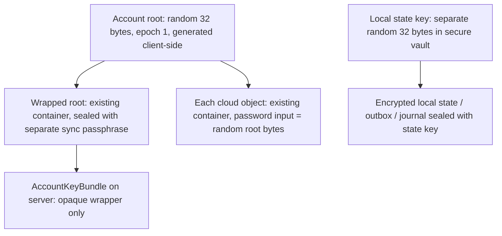

# SessionPort 0.2.0 -- Security

> **DRAFT -- awaiting owner approval. Architectural reference only; no implementation is claimed.**
> The crypto, auth, and storage policies below are proposed; candidate values are gate inputs, not
> defaults. **No production security audit has been performed or is claimed.** Standing safety
> constraints in `AGENTS.md` remain in force.
> Companion documents: [ARCHITECTURE.md](ARCHITECTURE.md), [SYNC_PROTOCOL.md](SYNC_PROTOCOL.md),
> [API_AND_DATA.md](API_AND_DATA.md).

## 1. Protection scope and non-protections

Intended protection: session content is end-to-end encrypted (E2EE) between the user's devices.
The cloud API, database, object storage, and web tier never hold plaintext session content, keys,
or content digests. Only a device that unlocks the account can decrypt uploaded revisions.

Explicit non-protections:

- **Native OpenCode session storage is plaintext and outside E2EE coverage** (the host session
  database is a host responsibility, not SessionPort's).
- A compromised or instrumented device (malware, keylogger, debugger, modified runtime) can observe
  credentials, keys, and decrypted data.
- Revocation cannot reclaim data that was already downloaded and decrypted by a revoked device.
- A server-side rollback of the wrapped key bundle cannot be globally detected; only a local
  maximum-epoch check detects a local rollback (section 4).
- JS zeroing is best effort only. There is **no secure-deletion promise** for memory or storage.
- Traffic/metadata analysis, side channels, and traffic volume are out of scope.
- Encryption proves possession of the passphrase, not identity; GitHub authentication proves
  account ownership, not device trust beyond the device-authorization grant.
- The plugin's upload limit is not a confidentiality boundary; the account root never reaches the
  server, but server operators still see opaque ciphertext, sizes, timestamps, and access patterns.
- Do not call any artifact or revision "secure". The candidate crypto policy is not approved, and
  the experimental local profile is not a production validation.

## 2. Key hierarchy

- **Account root**: 32 random bytes, epoch 1, generated client-side. Never sent to the server.
- **Wrapped root**: the root is sealed with the **existing container** using a **separate sync
  passphrase**. The wrapper is what the server stores.
- **Cloud objects**: each object is sealed with the existing container using the **random root
  bytes as the password input**. Therefore each object pays the container's explicit Argon2
  overhead. First release reuses this container path as-is; there is **no optimized derived-key
  API** until it is measured, justified, and approved.
- **State key**: a separate random 32-byte local state key, domain-separated from the content root,
  stored in the secure vault. Local state/outbox/journal ciphertext is sealed with the state key
  (reusing the container engine). The root is **not needed to read the device journal**; content and
  state keys are distinct.
- New-device authentication is **not** unlock: authentication proves the account, then the device
  fetches the wrapped root and the user supplies the sync passphrase to decrypt it.

## 3. Cloud crypto policy (CRYPTO-01)

- Minimal existing-container reuse, no new cipher-core refactor.
- Candidate numeric values (reused from the experimental local profile
  `sessionport-experimental-win-v1` in `src/tui/wiring/experimental-profile.ts`): libsodium
  Argon2id13 via `crypto_pwhash`, `opslimit = 2`, `memlimit = 128 MiB`, 16-byte random salt,
  64 KiB plaintext frames, XChaCha20-Poly1305 secretstream, gzip before encryption, password cap
  4096 bytes, artifact cap 66 MiB, decrypted gzip input cap 64 MiB, decompressed payload cap
  256 MiB, expansion ratio 128 (decompressed / decrypted compressed bytes).
- These values are **CANDIDATES, not approved inherited standards**. They are inputs to CRYPTO-01,
  which selects and finalizes the cloud crypto policy and tests resource behavior, including the
  **small key-wrapper payload** case (where per-object Argon2 overhead dominates).
- Per-object KDF repetition overhead (each object pays a full Argon2id pass) is measured in
  CRYPTO-01. An optimized derived-key path is a possible future change only after measurement,
  justification, and owner approval.
- The container retains its existing fail-closed properties: allow-listed profiles, bounded
  parameters before KDF, authenticated header/framing, required final tag, explicit caps, no
  fallback, no plaintext temp files.
- No production security audit is claimed. CRYPTO-01 includes a host resource/review gate.

## 4. Account key bundle lifecycle

- The key bundle is immutable per epoch. Epoch 1 is initialized with an **atomic create-if-absent**
  write.
- Two first-device races: the loser fetches the existing wrapper and prompts for the sync
  passphrase; it must not overwrite the winner's bundle.
- The wrapper contains `userID`, `keyEpoch`, `protocol`, and the base64 root; all fields are
  authenticated. The server stores the wrapper opaquely and cannot read the root.
- **Passphrase change**: create a new wrapper over the same root with a CAS update on
  `keyBundleVersion`. No ciphertext rotation and no re-encryption of stored objects.
- **Rollback caveat**: the server can roll back the wrapper, and there is no strong global rollback
  guarantee. A local maximum-epoch check detects only a local rollback (the device remembers the
  highest epoch it has seen).
- **Root compromise**: rotation and re-encryption are **not** an automatic 0.2.0 feature. Any
  rotation is an explicit operator/user procedure, and documentation must state that revoking a
  device cannot reclaim data that device already downloaded and decrypted.
- The account password does not exist; authentication is GitHub-based (section 6). The sync
  passphrase is distinct from authentication and from the account root.

## 5. Local key and credential storage (AUTH-02)

- Persisted auth keys and the root/state wrapping material require a **secure OS credential store**.
  Selecting that dependency is an explicit gate: evaluate a pinned keyring option (for example
  `@napi-rs/keyring`) after validation. If unavailable or locked, **fail closed**.
- Memory-only login/unlock is allowed as an alternative posture; there is **no plaintext fallback**
  for persisted keys.
- A locked keyring is a recoverable status: surface it and allow unlock/retry; do not degrade to
  plaintext or silently drop keys.
- The encrypted outbox/state directory is per-user, private, and outside the repository
  (see [SYNC_PROTOCOL.md](SYNC_PROTOCOL.md) section 8).

### 5.1 Local-state envelope decision — 2026-10-25

The owner approved a separate random 32-byte vault key and raw-key libsodium
XChaCha20-Poly1305, delegating the following format, limits, and namespace choices.
This does not change the checkpoint container or approve its candidate parameters.

- Envelope: ASCII `SPST`, version byte `1`, fresh 24-byte nonce, ciphertext with
  the 16-byte AEAD tag. Plaintext is capped at 67,108,864 bytes; the envelope at
  67,108,909 bytes. Exceeding either limit fails closed, without truncation.
- AAD: the full 29-byte header followed by three UTF-8 fields, each prefixed by
  its unsigned 32-bit big-endian byte length: `sessionport-local-state`, `1`, and
  the exact host scope. Scope is nonempty, at most 512 UTF-8 bytes, with no
  unpaired surrogates or U+0000–U+001F/U+007F controls; it is not normalized.
- Vault service: `opencode-session-port/local-state-key/v1`; account: lowercase
  SHA-256 hex of UTF-8 `sessionport-state-vault-account-v1\0${hostScope}`, where
  `\0` denotes a single NUL separator. This entry is separate from auth tokens.
- Key creation requires the state owner lock and an absent snapshot. An existing
  snapshot with a missing key fails closed; uncertain writes are not retried or
  overwritten. Local logout retains the state key and encrypted outbox.
- These are implementation decisions, not completed runtime/platform acceptance.
  File fsync plus rename has no established Windows power-loss durability claim;
  process-restart recovery is a separate, testable guarantee.

## 6. Authentication and device authorization (AUTH-01)

Chosen stack: **BetterAuth + `@better-auth/oauth-provider`** with `oauthProvider` +
`oauthDeviceAuthorization`, a **public native registered client** (`auth: none`), and the GitHub
provider. Source checked 2026-10-18:
`https://better-auth.com/docs/plugins/device-authorization` and
`https://better-auth.com/docs/plugins/oauth-provider`.

- A standalone `/device/token` returning a session token is **not sufficient** and is not used as
  the API credential.
- Device start: `/api/auth/device/code`. Token polling: OAuth token endpoint
  `/api/auth/oauth2/token` with the device grant; `offline_access` for refresh.
- BetterAuth owns its auth tables and migrations. The Prisma business schema is separate in the
  same database. Vendor schema versions are **not invented here**: pin and validate them in
  AUTH-01.
- Canonical issuer: `https://app.example.com/api/auth`. The Next BFF proxies the **same**
  `/api/auth/*` path to Fastify while preserving the trusted canonical origin; the authoritative
  API mounts that path; the GitHub OAuth callback is registered at the web BFF.
- Two verified principals only: the plugin uses a **device bearer token** checked against an active,
  bound device/grant row on every device request; the browser dashboard uses only a **cookie
  session** validated by Fastify through the same-origin BFF (plus CSRF/origin checks). The browser
  never holds a device bearer and the BFF cannot assert an arbitrary user.
- Every **device** API request must verify device-token claims (`aud` = API; issuer, signature,
  expiry, scopes) **and** check the server database for an active device/grant on every request, so
  application revocation takes effect immediately.
- The wrapped root / key bundle is **device-only**: the dashboard never retrieves it (see
  [API_AND_DATA.md](API_AND_DATA.md) section 1.1).
- The device row is bound through the approved vendor grant, never through a client-chosen header
  or ID. Vendor grant linkage is validated in AUTH-01.
- Proposed token configuration (candidates to validate; **not** claims about library defaults):
  access token 10 minutes; refresh 30 days sliding; absolute session 90 days; device code 10
  minutes; poll interval 5 s; code entropy vendor-validated; provider rate limiting enabled.
- Rotating refresh tokens use a **single-flight** client: persist the refreshed credential
  encrypted in the vault **before** reuse. If a refresh response is uncertain/lost, replay-safe
  behavior is required; until tested, fail and reauthorize rather than guessing. A small refresh
  reuse grace is a candidate only after an explicit gate. No bespoke auth is built silently.
- **Revocation**: the revocation API marks the device inactive in a transaction, then asks the
  provider to revoke the refresh grant. API access is denied immediately; already-signed S3 URLs
  remain valid until their short expiry (5 minutes candidate; see section 7).
- Web sessions: cookies are `HttpOnly`, `Secure`, `SameSite=Lax`, served via the same-origin BFF.
  CSRF protection uses origin/token checks and provider `state`. No wildcard CORS. No CLI token
  handling in JS. SessionPort adds no passwords of its own.

## 7. Storage and transport security (STORE-01)

- Private object bucket. Staging objects expire (5 minutes candidate) and are not served; final
  objects are immutable and unique per user, with no cross-user dedupe.
- Uploads never carry a client final write. The client receives a Post Policy with an exact
  content-length range and checksum, targeting a unique staging key. Completion validates via HEAD
  and a **conditional copy** to an immutable final key only if the source ETag is unchanged; the
  final object is HEAD-verified before the database marks it ready.
- Finalization is fenced with a **monotonic lease token plus lease expiry**, and final keys are
  unique per (upload, lease generation). A stale finalizer can therefore only write its own orphan,
  never overwrite the winning object; database fencing is not claimed to stop a late S3 copy.
  Cleanup deletes only unreferenced keys whose lease is terminal or fenced, re-checked under the
  lock, and never deletes the winning key.
- Provider capability is a hard requirement: Post Policy content-length range, checksum, HEAD, and
  conditional copy must be supported. An unsupported provider is **blocked**; there is no silent
  fallback to a weaker PUT and no proxying of large payloads through the API.
- Bucket versioning is **off** for staging (avoid noncurrent-version abuse). Staging may reappear
  until expiry because the Post Policy is reusable; cleanup is repeated and lifecycle rules apply.
  Final objects cannot change.
- Downloads are signing-only for ready, committed, authorized revisions; presigned URLs are
  candidates at 5 minutes and are bearer credentials -- revocation of a device does not revoke an
  already-issued URL before expiry. Arbitrary S3 keys are never allowed. The client fully validates
  every downloaded object before any host import.
- Server-side integrity uses the **ciphertext SHA-256**, never a plaintext hash. Plaintext content
  digests stay client-side and encrypted.

## 8. Threat model summary

| Scenario | Status |
| --- | --- |
| Server/DB/object-store reader without keys | Protected by E2EE (candidate policy; not audited) |
| Server operator observes metadata | Not protected: opaque IDs, sizes, timestamps, access patterns |
| Server rolls back key wrapper | Detected only against local max epoch; no global guarantee |
| Revoked device with downloaded ciphertext | Can remain decryptable if it kept keys; revocation cannot reclaim it |
| Compromised device during use | Out of scope |
| Native OpenCode session database | Plaintext; outside E2EE |
| Plaintext fallback attempt | Forbidden; no plaintext temp files by design |
| Unsupported storage provider | Blocked (STORE-01), not silently weakened |
| Stolen sealed objects | Require root bytes, which require the sync passphrase |

## 9. Failure cases

| Case | Behavior |
| --- | --- |
| Credential store unavailable/locked | Fail closed; memory-only allowed; no plaintext fallback |
| Wrapped root fetch fails | No unlock; retry after network recovery; never fabricate a root |
| Key-bundle CAS conflict | Surface conflict; re-fetch and re-prompt; never overwrite blindly |
| Decryption/auth check fails | Stop before parse/apply; nothing imported |
| Envelope/server metadata mismatch after decrypt | Stop; treat as tampering |
| Provider lacks required capability | Block uploads for that provider; no weaker path |
| Token expired during sync | Pause with bounded backoff; reauthorize; no busy loop |
| Refresh response uncertain | Fail and reauthorize (until replay-safe behavior is tested) |
| Device revoked mid-flight | API denies immediately; outstanding signed URLs expire at 5 min candidate |
| Quota exceeded | Upload blocked explicitly; local data unaffected |

## 10. Gates and research evidence

| ID | Gate focus | Evidence source |
| --- | --- | --- |
| CRYPTO-01 | Candidate policy selection; caps including the small wrapper payload; per-object KDF overhead; host resource/review | `src/core/crypto/*`, `src/tui/wiring/experimental-profile.ts`, archived decision-log T-09/T-11, O-01/O-03 |
| AUTH-01 | Library/provider feasibility: BetterAuth + oauth-provider pinned versions, migrations, canonical issuer, grants | `https://better-auth.com/docs/plugins/device-authorization`, `https://better-auth.com/docs/plugins/oauth-provider` (checked 2026-10-18) |
| AUTH-02 | Device + vault: credential-store dependency, encrypted state/outbox keys, fail-closed when unavailable | Section 5; [SYNC_PROTOCOL.md](SYNC_PROTOCOL.md) section 8 |
| STORE-01 | Provider Post Policy/checksum/HEAD/conditional-copy capability; immutable per-lease final keys; signing scope | [API_AND_DATA.md](API_AND_DATA.md) sections 4, 8 |
| STORE-02 | Upload quota: reservation/charge accounting, exactly-once charge, quota-block behavior | [API_AND_DATA.md](API_AND_DATA.md) sections 5, 7 |
| HOST-01 | Host release gate: no cloud native import/update before the gate; safe native APIs after; commands/events contract | [ARCHITECTURE.md](ARCHITECTURE.md) section 8 |
| SYNC-01 | Identities/state: logical-ID stability and mapping scope, encrypted state/outbox, normalization/digest parity | [SYNC_PROTOCOL.md](SYNC_PROTOCOL.md) sections 4, 8 |

## 11. Open items

- Owner approval of the candidate crypto reuse and the AUTH-01 token configuration.
- Keyring dependency selection and fail-closed UX (AUTH-02).
- Whether any refresh reuse grace is needed, and its validation.
- Documentation of the revocation limits (downloaded data cannot be reclaimed; signed URLs expire
  on their own clock).
